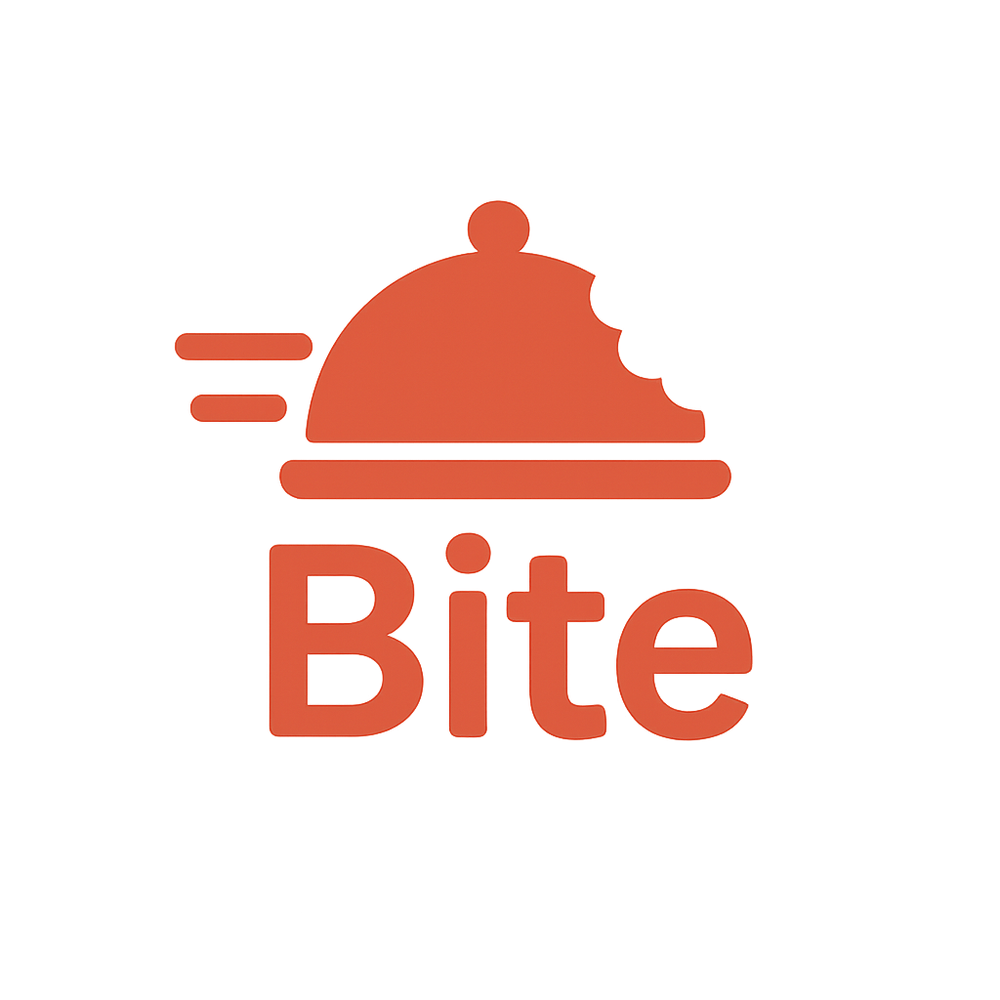

<p align="center">
  
</p>

<h1 align="center">🍔 Bite — Food Delivery App</h1>

<p align="center">
  A full-featured food delivery mobile application built with <strong>Flutter</strong> and <strong>Firebase</strong>.<br/>
  Stripe payments · Real-time order tracking · Push notifications · Dark mode
</p>

<p align="center">
  
  
  
  
  
  
</p>

---

## 📋 Table of Contents

- [Features](#-features)
- [Screenshots](#-screenshots)
- [Architecture](#-architecture)
- [Tech Stack](#-tech-stack)
- [Project Structure](#-project-structure)
- [Firebase Collections](#-firebase-collections)
- [Getting Started](#-getting-started)
- [Configuration](#%EF%B8%8F-configuration)
- [Dependencies](#-dependencies)
- [Contributing](#-contributing)
- [License](#-license)

---

## ✨ Features

<table>
<tr>
<td width="50%">

### 🔐 Authentication & User Management
- Email/Password & Google Sign-In
- Password reset via email
- Profile management (name, email, phone, photo)
- Onboarding flow for first-time users
- Remember me functionality

</td>
<td width="50%">

### 🍽️ Restaurant & Food Browsing
- Browse restaurants by location and category
- Real-time search with recent search history
- Restaurant details with ratings, delivery time & fees
- Menu browsing with category-based filtering
- Food item details with size & flavor selection

</td>
</tr>
<tr>
<td>

### 🛒 Shopping Cart & Checkout
- Add/remove items with quantity control
- Size and flavor customization per item
- Real-time price calculation
- Cart persistence via Firestore
- Delivery address selection with Google Maps
- Order summary review before placing

</td>
<td>

### 💳 Payment System
- **Stripe** integration with secure processing
- Multiple methods: Visa, Mastercard, PayPal, Cash on Delivery
- Save and manage credit/debit cards
- Automatic card type detection

</td>
</tr>
<tr>
<td>

### 📦 Order Tracking & History
- Real-time status: `Received → Preparing → Dispatched → Delivered`
- Floating action button for active order tracking
- Visual order timeline with courier details
- Ongoing/History tabs with reorder capability
- Cancel orders before dispatch

</td>
<td>

### 🔔 Notifications
- Push notifications via Firebase Cloud Messaging
- Local notifications for order status changes
- Notification history with read/unread states
- Toggle notifications on/off from settings

</td>
</tr>
<tr>
<td>

### ⭐ Ratings & Reviews
- Rate and review restaurants after delivery
- View your review history
- Star-based rating system

</td>
<td>

### ⚙️ Settings & Preferences
- 🌙 Dark mode / Light mode toggle
- Language selection support (i18n ready)
- App update checking via Firebase Remote Config
- FAQ section (Orders, Payments, Delivery)

</td>
</tr>
<tr>
<td colspan="2">

### ❤️ Favourites & Address Management
- Mark restaurants and food items as favourites
- Manage multiple delivery addresses with Google Maps integration
- Add, update, and delete saved addresses

</td>
</tr>
</table>

---

## 📱 Screenshots

<!-- Add your screenshots here -->
<!--
| Home | Restaurant | Cart | Track Order |
|:----:|:----------:|:----:|:-----------:|
|  |  |  |  |
-->

> 📸 *Screenshots coming soon — run the app to see the full UI!*

---

## 🏗 Architecture

The app follows a **clean, feature-first architecture** with the **BLoC/Cubit pattern** for state management. Each feature module encapsulates its own pages, cubits, models, and widgets.

```
┌───────────────────────────────────────────────────┐
│                   Presentation                    │
│         (Pages · Shared Widgets · Themes)         │
├───────────────────────────────────────────────────┤
│                State Management                   │
│            (26 Cubits / BLoC Pattern)             │
├───────────────────────────────────────────────────┤
│                   Data Layer                      │
│       (11 Models · Firebase · Stripe · Maps)      │
└───────────────────────────────────────────────────┘
```

### Feature Modules (19)

| Domain | Features |
|--------|----------|
| **Core Flow** | `home` · `restaurants` · `food_items` · `categories` · `search` |
| **Commerce** | `cart` · `checkout` · `payment` · `order_management_and_history` |
| **User** | `authentication` · `profile` · `address_management` · `favourites` |
| **Engagement** | `notifications` · `rating_and_reviews` · `faq_help_support` |
| **System** | `settings` · `splash_and_onboarding` · `app_update` |

### State Management — 26 Cubits

| Category | Cubits |
|----------|--------|
| **Auth** | `UserAuthCubit` · `RememberMeCubit` |
| **Shopping** | `RestaurantsCubit` · `FilterRestaurantsCubit` · `CategoriesCubit` · `CategorySelectionCubit` · `FoodItemCubit` · `SizeAndFlavourSelectionCubit` |
| **Cart & Orders** | `CartCubit` · `OrderCubit` |
| **Payments** | `PaymentCubit` · `PaymentMethodSelectorCubit` · `CreditCardCubit` · `CreditCardTypeSelectorCubit` |
| **User Data** | `AddressCubit` · `MapLocationCubit` · `FavouriteCubit` · `RecentSearchesCubit` |
| **Engagement** | `NotificationsCubit` · `RatingAndReviewCubit` · `RatingChangeCubit` |
| **UI / System** | `BottomNavigationSelectorCubit` · `SettingsCubit` · `FirstTimeLaunchCubit` · `UpdateCheckCubit` · `PhoneCallCubit` |

---

## 🛠 Tech Stack

| Layer | Technology |
|-------|------------|
| **Framework** | Flutter 3.10+ (Dart) |
| **State Management** | `flutter_bloc` / Cubit |
| **Backend & Auth** | Firebase Auth · Cloud Firestore |
| **Push Notifications** | Firebase Cloud Messaging + `flutter_local_notifications` |
| **Remote Config** | Firebase Remote Config |
| **Payments** | Stripe (`flutter_stripe` + `dio` for API calls) |
| **Maps & Location** | Google Maps Flutter · Geocoding · Location |
| **Responsive UI** | `flutter_screenutil` (375×812 design) |
| **Typography** | Google Fonts (Sen) |
| **Image Handling** | `cached_network_image` · `flutter_svg` |
| **Animations** | Lottie (loading, pull-to-refresh) |
| **Local Storage** | `SharedPreferences` |
| **Form Validation** | `form_builder_validators` |
| **Theming** | Material Design 3 — Light & Dark themes |

---

## 📁 Project Structure

```
lib/
├── main.dart                         # App entry point & initialization
├── firebase_options.dart             # Firebase platform configurations
│
├── app/                              # App-level routing, theme, providers & constants
│   ├── theme/                        # Light/Dark AppTheme and typography tokens
│   ├── routes/                       # Router definitions & route scopes
│   ├── constants/                    # Stripe and app-wide constants
│   └── bloc_providers.dart           # Root BlocProvider tree
│
├── core/                             # Core infrastructure & cross-cutting concerns
│   ├── di/                           # Dependency injection (GetIt)
│   ├── extensions/                   # Responsive, theme, spacing & currency extensions
│   ├── services/                     # Firebase & telephony services
│   └── utils/                        # SharedPreferences & persistence helpers
│
├── features/                         # Feature-first domain modules (Page -> Section -> Widget)
│   ├── authentication/               # Login, Signup, Forgot Password, User Auth
│   ├── home/                         # Home feed with restaurant listings & categories
│   ├── restaurants/                  # Restaurant details & catalog
│   ├── food_items/                   # Food item details, sizes & options
│   ├── categories/                   # Category browsing & filtering
│   ├── discovery/                    # Unified search & discovery
│   ├── cart/                         # Cart management & calculations
│   ├── checkout/                     # Checkout & payments
│   ├── orders/                       # Order history & live order tracking
│   ├── addresses/                    # Delivery address management
│   ├── favourites/                   # User bookmarks & favourites
│   ├── notifications/                # In-app & push notification handling
│   ├── reviews/                      # Ratings & reviews
│   ├── profile/                      # User profile & account details
│   ├── settings/                     # App settings, language & theme preferences
│   └── faq/                          # Frequently asked questions & support
│
└── widgets/                          # Global reusable UI primitives (cards, buttons, inputs)
│   │   ├── cart/                     # Shopping cart management
│   │   ├── checkout/                 # Checkout flow
│   │   ├── payment/                  # Stripe payments, card management
│   │   ├── order_management_and_history/  # Order tracking & history
│   │   ├── notifications/            # Push notification handling
│   │   ├── favourites/               # Favourite restaurants & items
│   │   ├── address_management/       # Address CRUD with Google Maps
│   │   ├── profile/                  # User profile management
│   │   ├── rating_and_reviews/       # Restaurant ratings & reviews
│   │   ├── settings/                 # App settings (theme, language)
│   │   ├── splash_and_onboarding/    # Splash screen & onboarding flow
│   │   ├── faq_help_support/         # FAQ section
│   │   └── app_update/               # Remote config update checking
│   │
│   ├── shared/
│   │   ├── widgets/                  # 16 reusable widgets (BiteAppBar, BiteSearchBar, etc.)
│   │   └── cubits/                   # Shared cubits (BottomNavigation)
│   │
│   ├── services/
│   │   ├── firebase/                 # Firebase Auth & Firestore connections, FCM setup
│   │   ├── cubit/                    # Bloc provider list
│   │   └── phone_call_cubit/         # Phone call service
│   │
│   └── routes/
│       └── page_routes.dart          # 24 named route definitions
│
├── assets/
│   ├── images/                       # App logo & decorative assets
│   ├── svgs/                         # SVG icons and illustrations
│   └── animations/                   # Lottie animations (loading, pull-to-refresh)
│
└── l10n/                             # Localization ARB files
```

---

## 🗄 Firebase Collections

| Collection | Description | Key Fields |
|-----------|-------------|------------|
| **UsersDB** | User profiles | `id`, `fullName`, `email`, `phoneNumber`, `photoUrl`, `token` |
| **RestaurantsDB** | Restaurant listings | `id`, `name`, `rating`, `deliveryFee`, `deliveryTime`, `isOpen`, `category` |
| **CategoriesDB** | Food categories | `id`, `name`, `image` |
| **FoodItemsDB** | Menu items | `id`, `name`, `price`, `sizes[]`, `flavors{}`, `isPopular`, `isAvailable` |
| **CartDB** | User cart (per user) | `cartID`, `userID` → *subcollection: Products* |
| **OrdersDB** | Order records | `orderId`, `userId`, `orderStatus`, `totalPrice`, `paymentMethod` |
| **NotificationsDB** | Push notifications | `id`, `userId`, `title`, `body`, `type`, `isRead` |

**Subcollections:** `Users → addresses` · `Cart → Products` · `Orders → Items`

---

## 🚀 Getting Started

### Prerequisites

- **Flutter SDK** 3.10.7 or higher
- **Dart SDK** ^3.10.7
- Firebase project configured
- Stripe account (test or live)
- Google Maps API key
- Android Studio / VS Code

### Installation

```bash
# 1. Clone the repository
git clone https://github.com/MuhammadWaleedEjaz21/bite-food-delivery.git
cd bite-food-delivery

# 2. Install dependencies
flutter pub get

# 3. Run the app
flutter run
```

### Firebase Setup

1. Create a project at the [Firebase Console](https://console.firebase.google.com/)
2. Enable the following services:
   - **Authentication** — Email/Password & Google Sign-In
   - **Cloud Firestore** — database
   - **Cloud Messaging** — push notifications
   - **Remote Config** — app update checks
3. Download `google-services.json` (Android) and `GoogleService-Info.plist` (iOS)
4. Update `lib/firebase_options.dart` with your configuration

### Stripe Setup

1. Get your test keys from the [Stripe Dashboard](https://dashboard.stripe.com/)
2. Pass `--dart-define=STRIPE_PUBLISHABLE_KEY=...` or configure `lib/app/constants/stripe_const.dart`

### Google Maps Setup

1. Get an API key from the [Google Cloud Console](https://console.cloud.google.com/)
2. Android: Add the key to `android/app/src/main/AndroidManifest.xml`
3. iOS: Add the key to `ios/Runner/AppDelegate.swift`

---

## ⚙️ Configuration

| File | Purpose |
|------|---------|
| `lib/app/constants/stripe_const.dart` | Stripe client publishable key configuration |
| `lib/firebase_options.dart` | Firebase platform configurations |
| `lib/core/services/firebase/fcm_initialize.dart` | FCM & local notification setup |
| `flutter_launcher_icons.yaml` | App icon generation config |
| `firebase.json` | Firebase hosting/deployment config |

---

## 📦 Key Dependencies

| Package | Purpose |
|---------|---------|
| `flutter_bloc` | State management (BLoC / Cubit) |
| `firebase_core` · `firebase_auth` · `cloud_firestore` | Firebase services |
| `firebase_messaging` · `flutter_local_notifications` | Push notifications |
| `firebase_remote_config` | Remote app configuration |
| `flutter_stripe` · `dio` | Stripe payment processing |
| `google_maps_flutter` · `location` · `geocoding` | Maps and geolocation |
| `flutter_screenutil` | Responsive design (375×812) |
| `google_fonts` | Custom typography (Sen) |
| `cached_network_image` · `flutter_svg` | Image loading & SVGs |
| `lottie` | Lottie animations |
| `shared_preferences` | Local key-value storage |
| `carousel_slider` | Onboarding carousel |
| `stylish_bottom_bar` | Custom bottom navigation |
| `equatable` | Value equality for BLoC states |
| `form_builder_validators` | Form field validation |
| `credit_card_type_detector` | Auto-detect card type |
| `skeletonizer` | Shimmer loading skeletons |
| `top_snackbar_flutter` | Top snackbar notifications |
| `custom_refresh_indicator` | Pull-to-refresh with Lottie |
| `flutter_rating` | Star rating widget |
| `uuid` | Unique ID generation |
| `url_launcher` | External link handling |
| `package_info_plus` | App version info |

---

## 🤝 Contributing

Contributions are welcome! Feel free to open issues or submit pull requests.

```bash
# 1. Fork the repository
# 2. Create your feature branch
git checkout -b feature/amazing-feature

# 3. Commit your changes
git commit -m "Add amazing feature"

# 4. Push to the branch
git push origin feature/amazing-feature

# 5. Open a Pull Request
```

---

## 📄 License

This project is open-source and available under the [MIT License](LICENSE).

---

<p align="center">
  Made with ❤️ using Flutter & Firebase
</p>
